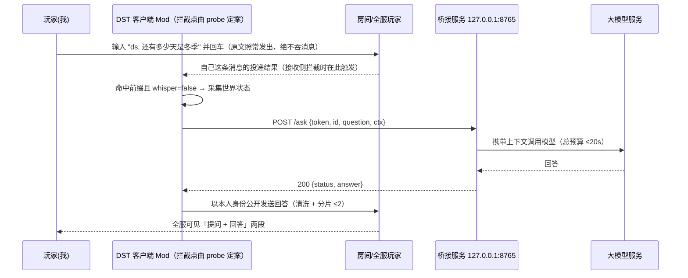

## 产品概述

在饥荒联机版（本机主机建房场景）中，为玩家（即应用启动者本人）提供一个"聊天框内直接问答"的能力：在全局聊天框输入 `ds: 还有多少天是冬季`，这条提问**照常以本人身份发到全局频道**，同时系统旁路采集当前世界状态交给大模型作答，再以**玩家本人身份**把回答追加发到全局频道，服务器内所有人都能看到。

## 核心功能

- **聊天框指令识别（旁路，不改原行为）**：命中前缀（默认 `ds:`）的聊天文本**仍按原样正常发送**，同时在旁路触发问答流程；非命中内容完全不受影响。即：玩家看到的是"提问 + 回答"两段自然对话，而不是提问被吞掉。
- **只作用于自己、且不碰私聊**：只识别本人发出的、非 whisper 的全局聊天；他人消息与他人提问一律不触发，私聊中的 `ds:` 也**不触发**（否则私聊内容会被全局广播）。
- **游戏上下文采集**：自动读取当前世界的季节、天数、季节剩余天数、季节长度、时段、玩家三维等状态，随问题一起提交。
- **大模型问答**：由本机桥接程序调用可配置的大模型服务（OpenAI 兼容接口 / Ollama）生成自然语言回答。**只回答与饥荒相关的问题**，其余礼貌拒绝；**单轮问答，不携带历史**（见 Non-goals）。
- **无感代发言与全服广播**：回答以玩家自己的角色名发出到全局聊天频道，其他玩家无需安装任何东西即可看到。
- **可控与克制**：回答长度分片、频率节流、超时兜底、可配置开关，避免刷屏与滥用。

## 交付形态

- 一个客户端 Mod（仅自己安装，其他人不装也能看到我的回答）。
- 一个本机手动启动的桥接程序（监听 127.0.0.1 的小型 HTTP 服务，打包为 exe，使用时双击运行）。
- （开发期）一个游戏内探测脚本，用于判定拦截点与通道行为，**不随发布物交付**。

---

## 〇、非目标（Non-goals，写死以免扩范围）

1. 不服务他人的提问：只有本人发出的、非私聊的 `ds:` 才触发。
2. 不做多轮对话/记忆：一次提问一次回答，不带上下文历史（追问"为什么"需重新完整提问）。
3. 不做游戏内 UI 面板、不展示历史记录、不做语音。
4. 不做翻译/多语言：回答固定中文，最长约 2 行。
5. 不承诺事实正确：回答带 `[AI]` 前缀，误答风险由使用者自担（README 说明）。
6. 不做跨机器部署：桥接只监听 `127.0.0.1`，不对外提供服务。

---

## 一、可行性结论（复核后修订）

**总体结论：可行，但"如何拦到这条聊天"是唯一尚未证明的前提；计划里所有其他部分都已落到确定实现，只有这一项必须先用 probe 实测定案，否则可能写完一整套代码才发现不触发。**

原方案曾把拦截点定为"包装 Lua 的 `SendRPCToServer` 拦 `RPC.Say`"。官方脚本反向文档（build 714014）显示 **ChatInputScreen 是通过 `TheNet:Say()` 发送消息的**（[Chatinputscreen 文档](https://vietnd69.github.io/dst-api-webdocs/docs/game-scripts/screens/chatinputscreen)），如果客户端聊天走 C++ 侧的 `TheNet:Say` 而不经过 Lua 的 `SendRPCToServer`，那么包装后者永远不会命中。因此本计划把"拦截点"降级为**待验证项**，并给出三个候选（见 §4.1）。

运行环境策略以**当前游戏版本**为准，不要停留在历史补丁说明上。原结论基于 Klei 两次改动：

| 版本 | 日期 | 对 Mod 的影响 |
| --- | --- | --- |
| 651414/651415 | 2025-01-24 | `io.open` 写入被完全禁止（只读）；`TheSim:QueryServer` 禁止访问第三方服务与任意 URL；`SetPersistentString` 禁止写入会被自动执行的敏感文件 |
| 653007 | 2025-02-05 | `TheSim:QueryServer` 在 client 与 server 均可访问 `localhost` / `127.0.0.1`；`io.open(path,"w")` 恢复部分能力：仅限 `unsafedata/` 目录、仅 `.txt/.tex/.xml/.png/.json`、仅 `"w"` 模式 |

**注意**：以上是 2025 年初的说明，而当前脚本文档已跟到 build 722832（2026-04）。**开工前必须按最新 changelog 复核"localhost 是否仍放行"**——这是整条主通道的地基，不能靠两年前的补丁说明长期背书（见 §8 第 0 步）。

| 链路 | 结论 | 依据 / 条件 |
| --- | --- | --- |
| 识别聊天输入 | ⚠️ **待 probe 定案（最大不确定性）** | 官方脚本显示 ChatInputScreen 用 `TheNet:Say()` 发送；三个候选拦截点见 §4.1，开工第一件事是用 `tools/probe_hooks.lua` 判定哪个真的会触发 |
| 读取游戏状态 | 可行 | `TheWorld.state` 提供 season / cycles / remainingdaysinseason / elapseddaysinseason / phase 等 netvar；**HUD 天数 = cycles + 1**；玩家三维必须走 `ThePlayer.replica.*`（client 环境无 `components`，`talker` 除外，见 §2-10） |
| 调用大模型 | **Mod 内不可行** | Mod 的 Lua 环境无 socket；`QueryServer` 仅允许 localhost（第三方域名被封）→ 必须外置桥接 |
| 与桥接程序通信 | 可行，主通道为 HTTP | `TheSim:QueryServer(url, cb, "POST", body, timeout)`，回调 `cb(response, success, code)`；仅 GET/POST、不能自定义 header；**body 是否被 URL 编码、是否带 Content-Length 需实测**（见 §10） |
| 以本人身份广播 | 可行，但通道需二选一实测 | 首选 `SendRPCToServer(RPC.Say, answer)`（`RPC.Say` 是合法的客户端→服务端 RPC，预计与手动打字走同一套服务端校验，须实测）；备选 `TheNet:Say(answer, false)`（**client env 是否可调需验证**）。前者会再次经过自己的包装器，必须做重入保护 |
| 只在全局频道生效 | 必须显式实现 | 聊天框有 SAY/WHISPER 切换；`ds:` 出现在私聊里也会匹配前缀 → 必须判 `whisper == false`，否则私聊被公开广播 |

**必须满足的前置条件**

1. **当前版本仍放行 `TheSim:QueryServer` 访问 localhost**（§8 第 0 步复核；低于 653007 只能走文件通道）。
2. 桥接程序与游戏同机运行，监听 `127.0.0.1`（监听 `0.0.0.0` 既无必要也会触发防火墙提示）。
3. 大模型服务可用（云端需 API Key 与联网；本地需 Ollama 已启动）。
4. 拦截点已由 probe 定案，且能拿到"自己发出的、非私聊的"消息文本。
5. 聊天有长度与频率限制，长回答必须分片，且**必须按 UTF-8 字符边界切分**（Lua 5.1 的 `#s` 是字节数，`string.sub` 会切坏汉字）。
6. 若启用文件兜底：需手动创建 `unsafedata` 目录（Mod 无法建目录），且 exe 能定位到它。**文件通道默认不实现**（见 §9）。

---

## 二、接口核查表（逐条判定）

这是复核中改动最大的部分。判定含义：**❌ = 直接写错，照原样实现会失败；⚠️ = 需改写或补约束；✅ = 可用，但仍要按备注使用。** 其中 #4 是原方案漏掉的最优通道，#5 是最新发现的最高风险项，#15/#16 是上一轮复核没覆盖的空白。

| # | 原方案写法 | 结论 | 说明与修正 |
| --- | --- | --- | --- |
| 1 | `TheNet:Say(msg, false)` 以本人身份广播 | ✅ 可用（client env 待验证） | `TheNet` 是 C++ 侧的 NetworkProxy，Lua 里拿不到方法定义但可正常调用；`whisper=false` 为全局。**不要去替换 `TheNet` 的方法**（userdata 上的 C 方法）。若实测 client env 不可调，改用 `SendRPCToServer(RPC.Say, msg)` + 重入保护 |
| 2 | `TheSim:SetPersistentString(name, data, encode, cb)` | ⚠️ 参数含义写错 | 第三个参数是**是否压缩**，不是"编码"。传 `true` 会写入二进制，exe 读不到明文 JSON → **必须传 `false`**。回调是 `cb(success)`；读用 `GetPersistentString(name, cb)`，`cb(success, data)`。默认落盘 `%USERPROFILE%\Documents\Klei\DoNotStarveTogether\<userid>\client_save\<name>` |
| 3 | `io` 库"只能作为可选加速手段" | ⚠️ 需改写 | 651414 起 `io.open` **完全不能写**；653007 起仅允许 `unsafedata/` + 白名单扩展名 + `"w"` 模式。**`unsafedata` 目录必须预先存在**，否则返回 `No such file or directory` |
| 4 | 未提及 `TheSim:QueryServer` | ❌ 漏掉最优通道 | `QueryServer(url, cb, method, encoded_data, timeout)`，`cb(response, is_success, code)`；仅 GET/POST，只能改 body 不能改 header；653007 起允许 localhost。**应作为主通道** |
| 5 | 包装 `SendRPCToServer` 拦 `RPC.Say` | ❌ **可能不命中（改为待验证）** | 官方脚本显示 ChatInputScreen 用 `TheNet:Say()` 发送 → Lua 侧 `SendRPCToServer` 可能拿不到这条聊天。参见 §4.1 的三个候选与判定方法；`AddClassPostConstruct("screens/chatinputscreen", fn)` 的内部方法名随版本变，只能作备选 |
| 6 | 前缀 `/ds` | ❌ 会撞斜杠命令 | DST 对 `/` 开头文本有斜杠命令解析（`/roll` `/emote` `/w` `/kick`…），未知命令可能在本地被吞或报错，**根本不会进聊天发送路径**。改为 `ds:` 或 `!ds` |
| 7 | 前缀只认 `ds:` | ⚠️ 中文输入法会打全角冒号 | IME 默认输出 `：`，`ds：还有多少天` 匹配不上 → 匹配前先归一化（`：`→`:`、全角字母转半角、转小写）再比较 |
| 8 | `TheWorld.state` 读 season / cycles / remainingdaysinseason | ✅ 正确，需注意语义 | `season` ∈ autumn/winter/spring/summer；`remainingdaysinseason`、`elapseddaysinseason`、`phase`、`isday/isnight`、`israining/issnowing`、`moonphase` 均为 netvar。**`cycles` 比 HUD 显示天数小 1**（HUD = `cycles+1`） |
| 9 | 季节长度取 `TheWorld.state.*length` / `TUNING.*_LENGTH` | ⚠️ 兜底口径不可靠 | 客户端 `TUNING` 是**默认值**，主机把季节改成"短/长"后就不对。零猜测做法：`当前季节长度 ≈ elapseddaysinseason + remainingdaysinseason`（两个都是 netvar）；`TUNING` 只做两者都取不到时的最后兜底 |
| 10 | `ThePlayer` 三维 | ❌ 客户端取法错误 | 客户端环境没有 `components`，只有 replica：`ThePlayer.replica.health:GetPercent()`、`replica.hunger:GetPercent()`、`replica.sanity:GetPercent()`。hook 跑在 client env，即使主机建房也必须用 replica |
| 11 | 仅本地提示用 `ThePlayer.components.talker:Say` | ✅ 可用，但与上一条需分清 | `talker` 是**客户端组件**（头顶气泡），client env 可调用；该 API 不存在时退化为 `TheFrontEnd` 提示或本地刷一条聊天气泡。一句话规则：**数据走 replica，提示走 talker** |
| 12 | JSON 编解码 | ✅ 可用 | Mod 环境自带 `json.encode/decode`；只用扁平 string/number/boolean/table，避免嵌套过深 |
| 13 | UTF-8 分片"逐字符累积字节数" | ⚠️ 无库可用，且单位要统一 | DST 的 Lua 5.1 不保证有 `utf8` 库，需自写 `Utf8Len` / `Utf8Sub`（按首字节判断 1~4 字节序列）。**长度预算统一按字节算**（建议每片 ≤150 字节），不要一会儿"字节"一会儿"60 个中文字符" |
| 14 | modinfo 配置项含"指令前缀" | ⚠️ 不支持自由文本 | 配置项类型只有 checkbox / slider / select 等，没有文本输入框 → 前缀做成 select 预设（`ds:` / `!ds` / `ds `） |
| 15 | 桥接口令 token | ⚠️ 原先没有下发路径 | Mod 侧无法读取任意文件做握手，modinfo 又没有文本框 → token 只能**作为常量写进 modmain**（modmain.lua 里一个字段），并在 README 明确"它不是安全边界，只用于防串台"；桥接另加 `Origin`/`Host` 校验挡掉浏览器与 DNS rebinding |
| 16 | 版本自检 | ⚠️ API 名称未确认 | `TheSim:GetBuildDate()` 与 `TheSim:GetBuild()` 二者以实测为准，别在方案里写死；且版本门槛应写"按最新 changelog 复核"，而不是永久固定为 653007 |

---

## 三、总体架构（修订版）



**兜底通道（配置项 `channel = http | file`）**

- `file`：Mod 写 `unsafedata/ds_req_<id>.json`（`io.open("w")`），每 0.5s 读 `unsafedata/ds_res_<id>.json`；不可用时再退到 `SetPersistentString`（`client_save`）。
- **默认不实现**：它是唯一同时带"目录权限、落盘竞态、路径发现"三重不确定性的通道，且 HTTP 主通道的验证成本只有一个 probe。先冻结设计，等 §9 第 5 步再决定是否值得写。

**设计要点**：Mod 只做四件事（识别、采集、发请求、发言），且**识别是完全旁路的——原文一律照常发出，绝不吞消息**；联网与模型逻辑全在桥接；桥接零第三方依赖（Python 标准库 `http.server` + `urllib`），PyInstaller 打包更省事。

---

## 四、实现要点

### 模块一：Mod（`mod/modmain.lua`）

> 注意文件名：DST 只认 mod 根目录的 `modinfo.lua` + `modmain.lua`。写成 `mod.lua` 或 `mod/main.lua` 都不会被加载。

**1.（§4.1）拦截点：三个候选，先用 probe 定案**

| 候选 | 位置 | 优点 | 风险 |
| --- | --- | --- | --- |
| A. 发送侧 `SendRPCToServer` | 包装全局函数，判 `rpc == RPC.Say` | 最干净、零侵入 | **可能根本不被调用**（若聊天走 `TheNet:Say`） |
| B. 发送侧 `TheNet:Say` 代理 | 把全局 `TheNet` 换成带 `__index` 的转发 table | 能命中 UI 调用 | 侵入式替换，漏掉 C++ 内部调用；可能干扰其他 Mod |
| C. 接收侧回声 | 挂聊天队列 widget 的 `AddChatLine` 一类入口，按"自己 guid + 前缀"识别 | 语义最好：消息已被服务器接收并回显，**天然满足"不吞消息"**，不依赖发送路径实现细节 | UI 层 API 随版本变；必须防重入/防重复 |

判定方法：`tools/probe_hooks.lua` 分别包装/监听三处，各打印一行 `[probe] A hit` / `B hit` / `C hit` 到 `client_log.txt`；游戏内发一条 `ds: hi`，看哪几行出现。**A 与 C 同时命中是正常且期望的**（C 更稳，可作主用，A 作旁证）；只有 B 命中则要额外评估侵入性。

推荐形状（接收侧为主、发送侧作旁证）：

```lua
-- 归一化：全角冒号/全角字母→半角、转小写（中文输入法默认打出的是「：」）
local function Normalize(s)
    local map = { ["："] = ":", ["％"] = "%", ["Ｄ"] = "d", ["Ｓ"] = "s" }
    return (tostring(s):gsub("[：%％ＤＳ]", map):lower())
end

local PREFIX = Normalize(GetModConfigData("prefix"))   -- 配置项来自 select，此处仍需归一化
local answering = false                                -- 回答正在发送时的重入闸门
local last_trigger = { text = nil, t = 0 }             -- 1s 窗口去重

-- 命中返回问题文本，否则返回 nil。whisper 必须为 false。
local function IsTrigger(text, whisper)
    if whisper or type(text) ~= "string" then return nil end
    local t = Normalize(text)
    if t:sub(1, #PREFIX) ~= PREFIX then return nil end
    local q = (t:sub(#PREFIX + 1):gsub("^%s+", ""))
    if q == "" then return nil end
    return q
end

local function OnChatObserved(text, whisper)
    if answering then return end                 -- 别把 AI 的回答当成新问题
    local q = IsTrigger(text, whisper)
    if not q then return end
    local now = os.time()
    if last_trigger.text == q and now - last_trigger.t <= 1 then return end
    if not TheWorld or not ThePlayer then return end  -- 加载中/切洞中直接跳过
    last_trigger.text, last_trigger.t = q, now
    local ok, err = pcall(AskAI, q)              -- 异步：内部只发 HTTP，立即返回
    if not ok then Log("AskAI failed: " .. tostring(err)) end
end
```

要点：

- **顺序必须是"先放行、后触发"**。这样聊天发送的成功路径完全不依赖 AI 逻辑，桥接没开、模型挂了、JSON 编码失败，玩家的话照样发得出去。
- `answering` 闸门：如果回答走 `SendRPCToServer(RPC.Say, answer)`，该调用会再次经过包装器（同步），此时必须靠 `answering` 直接返回；同时**回答文本绝不能以 `ds:` 开头**（双保险）。走 `TheNet:Say` 时该闸门仍要保留，因为接收侧回声一定会再看到自己这条回答。
- 只观察消息文本，其余参数/返回值原样透传，不改变其他 Mod 对被包装函数的预期。
- `__DS_PATCHED` 防重复包装（modmain 被多次执行 / 重载）；另加 1 秒窗口去重，只针对同文本。
- 因为原文会公开出现，前缀 `ds:` 天然起到"这是向 AI 提问"的标识作用；回答建议再加可配置前缀（如 `[AI]`）以便区分。

**2. 采集上下文**（全部做 nil 保护，客户端 netvar 可能短暂为 nil）

```lua
local s = TheWorld.state
local elapsed, remaining = s.elapseddaysinseason, s.remainingdaysinseason
local ctx = {
    day = (s.cycles or 0) + 1,             -- HUD 口径
    season = s.season,
    season_cn = SEASON_CN[s.season],
    season_day = elapsed and math.floor(elapsed) + 1 or nil,
    remaining_days_in_season = remaining,
    elapsed_days_in_season = elapsed,
    season_length = (elapsed and remaining) and (elapsed + remaining) or nil,  -- netvar 反推，不猜 TUNING
    phase = s.phase,                        -- day/dusk/night
    is_cave = TheWorld:HasTag("cave"),      -- 若客户端 tag 不同步，改用 shard id 双判
    days_to_winter = DaysToSeason(s, "winter"),
    is_winter_now = s.season == "winter",
    next_season = NextSeason(s.season),
    days_to_next_season = remaining and math.ceil(remaining) or nil,
    player = {
        name = ThePlayer and ThePlayer:GetDisplayName() or "",
        health_pct = Pct(ThePlayer and ThePlayer.replica.health),
        hunger_pct = Pct(ThePlayer and ThePlayer.replica.hunger),
        sanity_pct = Pct(ThePlayer and ThePlayer.replica.sanity),
    },
}
```

`DaysToSeason` 的**口径必须写死并在 prompt 里重复一遍**，避免模型二次推算：

- 当前季节就是目标季节 → 返回 `0`，并置 `is_<season>_now = true`；
- 目标季节在当前季节之后 → `ceil(remaining) + 中间各季节长度`（中间季节取 `TUNING` 兜底，因为客户端只能反推当前季节）；
- 目标季节在环上更远（跨年）→ 按"下一个同季节"计算，`ceil(remaining) + 后续季节长度之和`；
- 数字口径注释写清"今天算不算一天"（约定：**`remainingdaysinseason` 含今天，因此"明天入冬"返回 1**）。

**把结论直接给模型，而不是让模型做日期算术**，能显著降低幻觉。

**3. 发请求**

```lua
TheSim:QueryServer(URL .. "/ask", function(res, ok, code)
    -- res: 响应 body；ok: 布尔；code: HTTP 状态码
end, "POST", json.encode(payload), 20)
```

注意：

- 回调参数顺序按实测确认（方案按 `(response, success, code)` 写，`ok=false` 时多半是桥接没启动）。
- 提示统一走 talker（仅本地可见，不刷全局），见 §2-11。
- **超时预算**：`QueryServer` 的 timeout 必须 ≥ 桥接侧的最坏总耗时（连接 5s + 读 8s + 重试 1 次 ≈ 20s），因此桥接把单次读超时压到 **8s**、总预算 **≤20s**，`QueryServer` 传 **20**。原方案"读超时 20s + 重试 1 次（40s）配 25s 超时"是算术矛盾，重试永远来不及。

**4. 广播与分片**

- 发送通道：优先 `SendRPCToServer(RPC.Say, text)`（与自己打字同路径）；若实测 `TheNet:Say(text, false)` 在 client env 可用，则两者择优，选一个做唯一定义（`SayPublic`），不要两条路径并存。
- 分片按 UTF-8 字符边界切，**统一按字节预算**（**每片 ≤150 字节 ≈ 50 汉字，最多 2 片**）；片间 `DoTaskInTime(0.6, ...)` 串行发送，避免顺序错乱。
- 每片发送前检查 `ThePlayer and ThePlayer:IsValid()`：切洞/死亡/退出会让实体失效，否则回调里抛错。
- 发送前清洗：去掉换行、markdown 符号、emoji（DST 字体不支持）、首尾空白；回答不得以 `ds:` 开头。
- 队列化：**因为提问原文已经公开发出，被直接丢弃的提问会很突兀**，所以允许排队（深度 2），超出才拒绝；拒绝提示只走 talker（仅自己可见），不刷全局。
- **single-flight**：同一时刻只允许 1 个在途请求，其余 FIFO，保证"先问先答"，避免两问两答错序。
- 失败必给反馈：HTTP 失败/超时/模型报错时用 talker 提示（"AI 暂时没答上来"）；可选配置允许把简短错误也广播出去（默认关）。
- 进世界时做一次 `/health` 自检（结果缓存 10s），失败即 talker 提示"AI 桥接未启动"，避免公共聊天里出现一个没人回答的问题。

### 模块二：桥接（`bridge/`）

- `server.py`：标准库 `http.server`。**若坚持"串行"，用单线程 `HTTPServer`（或显式加锁 + 队列），不要用 `ThreadingHTTPServer` 又假设串行**。`POST /ask`、`GET /health`（返回 `{status, version}` 便于发现旧 exe）；只绑 `127.0.0.1`；校验 `token`；另拒 `Origin` 非空且非本机的请求（防网页/DNS rebinding 打本地端口）；队列满返回 **429**（带 `Retry-After: 5`）。
- `providers.py`：`openai_compatible`（`/chat/completions`）与 `ollama`（`/api/chat`）统一 `generate(system, user) -> str`。
- `prompt.py`：系统提示词 + 上下文渲染；要求"只输出最终回答、单行、中文、≤50 字、不用 markdown、不做算术（直接用给定数字）、只答与饥荒相关的问题，其余礼貌拒绝"。
- 性能：`temperature 0.3`、`max_tokens 200`、连接超时 5s / **读超时 8s**、失败重试 1 次、**总预算硬上限 20s**。
- 日志：滚动文件，记请求摘要、耗时、错误；**不记录 API Key**；问题原文只在 debug 级别落盘；不落库原始对话。
- 配置：`config.toml` 只放非敏感项；API Key 支持环境变量覆盖（`DS_AI_API_KEY`），避免明文配置进版本库。

---

## 五、协议

**HTTP（主）**

```
POST http://127.0.0.1:8765/ask
{ "token": "本地共享口令", "id": "1730000000",
  "question": "还有多少天是冬季",
  "ctx": { "day": 13, "season": "autumn", "remaining_days_in_season": 8,
           "season_length": 20, "days_to_winter": 8, "next_season": "winter",
           "days_to_next_season": 8, "player": {...} } }

200 { "status": "ok", "answer": "还有 8 天进入冬季，建议提前准备保暖石和食物。" }
429 { "status": "error", "error": "bridge_busy", "retry_after": 5 }
```

`GET /health` → `200 { "status": "ok", "version": "0.1.0" }`

错误码统一：`400` 参数缺失 / `403` token 或 Origin 不对 / `429` 队列满 / `502` 模型侧失败 / `504` 模型超时。

**文件（兜底，UTF-8 JSON，默认不实现）**

```
unsafedata/ds_req_<id>.json  ← Mod 写（io.open "w"）
unsafedata/ds_res_<id>.json  ← 桥接写
```

请求文件用"唯一 id 文件名"而非固定文件名，可避免"擦除文件"与"读取半截"两类竞态；Mod 侧只记已处理过的最大 id。

---

## 六、目录结构

```
dst-ai-chat/
├── mod/
│   ├── modinfo.lua        # api_version = 10（文档站示例值，以当前模板为准）、client_only_mod=true、不设 all_clients_require_mod；
│   │                      # 配置项：channel(select)、prefix(select)、max_shards(slider)、enabled(checkbox)、
│   │                      #        reply_prefix(select，如 [AI])、reject_in_chat(checkbox)
│   └── modmain.lua        # 拦截点（probe 定案后二选一）/ 采集上下文 / QueryServer 或文件通道 / 分片广播
├── bridge/
│   ├── server.py          # 127.0.0.1 HTTP 服务：/ask、/health、token+Origin 校验、单线程/队列
│   ├── providers.py       # openai_compatible / ollama 适配
│   ├── prompt.py          # 系统提示词与上下文渲染
│   ├── config.toml        # provider、base_url、model、端口、超时（token 与 key 走环境变量/常量）
│   ├── requirements.txt   # 无第三方依赖（可选 tiktoken 之类都不要）
│   └── build_exe.py       # PyInstaller 打包（建议 --onedir，见 §7）
├── tools/
│   ├── probe_hooks.lua    # ★新增：判定三个候选拦截点是否命中（§4.1）
│   ├── probe_query.lua    # 通道/长度/字段可用性探测
│   └── smoke.md           # 冒烟测试清单与判定标准（与 §8 同步）
└── README.md              # 用法、token 语义、API Key 放置、误答免责、其他玩家视角说明
```

---

## 七、风险与对策

| 风险 | 影响 | 对策 |
| --- | --- | --- |
| **拦截点不命中**（聊天走 `TheNet:Say` 而非 Lua 的 `SendRPCToServer`） | 整套逻辑永不触发 | **第 0 步先跑 `probe_hooks.lua`**；三候选并存评估，优先接收侧回声（最稳且语义最好） |
| 回答被自己再次识别 → 自问自答循环 | 刷屏、烧额度 | `answering` 闸门 + 回答绝不以 `ds:` 开头 + 只在 `whisper=false` 时触发 |
| 私聊里的 `ds:` 被全局回答 | 隐私泄漏 | 严格判 `whisper == false`；冒烟用例专门覆盖 |
| Klei 再次收紧 localhost 放行 | HTTP 主通道失效 | 开工前按最新 changelog 复核（不背书 2025 年的补丁说明）；`channel=file` 仅留设计，真需要时再实现 |
| 游戏版本 < 653007（含部分 WeGame 老客户端） | QueryServer 被拒 | 用实测可用的版本 API 自检，直接切文件通道（或直接不支持） |
| 超时预算不足 | 重试成死代码、回答必然迟到 | 桥接读超时 8s、总预算 20s，`QueryServer` 传 20；single-flight 避免排队叠加 |
| `/` 前缀被命令解析吞掉 | 拦截不生效 | 默认 `ds:`；前缀做归一化，兼容全角 `：`、大小写 |
| `SendRPCToServer` 被其他 Mod 也包装 | 叠加顺序问题 / 重复回答 | 只观察不改变参数与返回值；`__DS_PATCHED` 防自叠；1s 窗口去重 |
| 聊天长度/限流未知 | 回答被截断或丢片 | 按字节预算（≤150B/片，≤2 片）+ 片间 0.6s + 实测临界值；冒烟补"3 条连发"用例 |
| 暂停/加载界面时 QueryServer 回调延迟 | 回答晚到 | 20s 超时 + 超时仅本地提示 |
| 主机在洞穴/地表分片切换 | `TheWorld` 或 netvar 为空 | 全字段 nil 保护 + 发送前 `IsValid()`；缺字段就少传而不是报错 |
| 桥接未启动/端口占用 | 提问无响应 | 进世界时 `/health` 自检（缓存 10s），失败用 talker 提示 |
| PyInstaller 单文件被 Defender 误报 / 启动解压慢 | exe 打不开 | 用 `--onedir` 分发；README 说明加白名单方法 |
| 刷屏与礼仪 | 影响同房玩家 | 每次提问固定占 **1 行原文 + 1~2 行回答**，按提问频率限流（≥5s 一次）、回答 ≤50 字、最多 2 片 |

---

## 八、冒烟测试清单（按序，每步有明确判定）

0. **前置复核（新增，最先做）**：① 查当前 build（`TheSim:GetBuild()` / `GetBuildDate()` 二选一实测）；② 按**最新** changelog 确认 localhost 放行仍有效；③ 找到 `mods` 目录（Steam 版在游戏根目录 `mods/`；WeGame 版路径不同需单独确认）；④ 如需兜底则手动建 `unsafedata/`。
0.5. **拦截点（新增，最关键）**：装 `tools/probe_hooks.lua`，游戏内发 `ds: hi`。判定：`client_log.txt` 出现 `[probe] ? hit`；据结果在 §4.1 三候选里定案并回填计划。**此步不通过，后面全部无意义。**
1. **广播能力**：控制台执行 `SendRPCToServer(RPC.Say, "test")`（以及 `TheNet:Say("test", false)`，两者分开测）。判定：全局聊天出现自己名字的消息，且**只出现一次**（验证主机本地无重复回显）；记录哪一种在 client env 可用。
2. **下游能力**：控制台直接调 `AskAI("测试")`（绕过聊天输入，跳过识别层）。判定：固定字符串成功广播，且分片顺序正确。
3. **前缀识别（关键一步）**：聊天框输入 `ds:hi`（再试 `DS：hi` 全角版）回车。判定：① 原文**正常出现在全局聊天**，全服可见且只出现一次；② 随后回答到达；③ 全程只触发一次，**没有自问自答循环**；④ 无"未知命令"类报错。再输入 `hello` 验证不触发。
3.5. **私聊不触发（新增）**：切到 WHISPER 模式发 `ds: hi`。判定：**原文只出现在私聊，且不产生任何全局回答**。
4. **通道**：浏览器访问 `http://127.0.0.1:8765/health` → 200 且带 version；Mod 发一次 `/ask` 并把回调三个参数打到 `client_log.txt`。**重点验证 body 是否被 URL 编码、Content-Type、是否带 Content-Length**（服务端两种解析都兼容）。
5. **长度上限**：控制台依次 `SendRPCToServer(RPC.Say, string.rep("测", N))`，N = 20 / 40 / 50 / 80 / 120。判定：记录截断或报错的临界值（按字节折算），回填到配置默认值。
5.5. **连发限流（新增）**：间隔 0.3s 连发 3 条。判定：3 条全部到达且顺序正确；若被服务器限流，记录最小安全间隔并回填 0.6s。
6. **上下文正确性**：把 `ctx` 全量打到 `client_log.txt`，与 HUD 天数、季节、剩余天数逐项对照；确认 `cycles+1` 口径正确、`season_length` 与实测季节长度一致、replica 数值合理。
7. **接模型**：走全链路，观察耗时（预期 1–5s）、分片顺序、异常路径（拔网线 / 关桥接 / 超时），确认**总耗时 < 20s**。
8. **边界**：空问题、超长问题（>200 字）、连续提问、切洞切换后提问、暂停中提问、死亡/重生后提问。

---

## 九、实施顺序

0. **probe 定案**：`probe_hooks.lua` 判拦截点 + 当前版本 localhost policy 复核。任一不成立就换方案（接收侧 / 文件通道 / 放弃），**不要先写实现**。
1. **最小闭环**（不含模型）：命中 `ds:` → 原文照发 + 固定字符串回答广播。验证"识别不吞消息 + 代发言 + 无自触发"三件事。
2. **通道打通**：桥接 `/health` + `/ask` 回声，验证回调、超时预算、异常提示。
3. **上下文**：采集 + 落日志核对，写 `DaysToSeason` 预算逻辑与口径注释。
4. **接模型**：prompt 边界（只答游戏问题、单轮）、清洗、分片、节流、single-flight。
5. **打包与（可选）兜底**：版本自检、PyInstaller（`--onedir`）、README；**文件通道默认不做**，只有在第 0 步证明 HTTP 不可用时才补。

任一环节不成立都能就地降级（例如改 `!ds` 前缀、改接收侧拦截、改文件通道），不必推翻整体。

---

## 十、待实测确认（Open Questions）

> 查证口径与资料入口见 [AGENTS.md](AGENTS.md)：接口文档站（自动摘要，每页带 `Based on game build`）+ 源码仓库（精确实现，本环境暂不可达）。答了的条目直接删掉或改写，别留着过期条目。

1. **客户端聊天到底走哪条路径**：`TheNet:Say` / `SendRPCToServer(RPC.Say)` / 只走 C++？（决定拦截点，§4.1）
2. **client env 能否调用 `TheNet:Say`**；以及它的参数顺序（`whisper` 在第几位）。
3. `SendRPCToServer(RPC.Say, text, whisper)` 的第二个参数是否就是 whisper 标志（私聊过滤依赖它）。
4. `QueryServer` 的 POST body 是否被引擎做 URL 编码；实际 `Content-Type`；**是否发送 `Content-Length`**（若不发，`http.server` 读不到 body，需改用原始 socket 解析或改 `GET` + query 承载）。
5. `QueryServer` 响应体大小上限与截断行为。
6. 单条聊天上限（字符 vs 字节）、以及连发 2–3 条是否被服务端限流或乱序。
7. 服务器词表过滤会不会改动消息原文（若会，接收侧匹配前缀是否仍可靠）。
8. `TheWorld.state` 是否真有 `autumnlength/winterlength/...` 一族字段（若有，优先于 `elapsed+remaining` 反推）。
9. 游戏被暂停（Esc / 自动暂停）时 `QueryServer` 回调是否仍会触发；加载界面中是否触发。
10. `unsafedata` 目录的相对根（仅在实现文件通道时才重要）。
11. 客户端 `TheWorld:HasTag("cave")` 是否可用（否则改用 shard id 判定）。
12. `SendRPCToServer` / 聊天接收回调是否会在重连、输入法回车等场景重复触发（决定去重窗口取值）。
13. 当前版本可用的版本号 API 名（`GetBuild` / `GetBuildDate`）。
